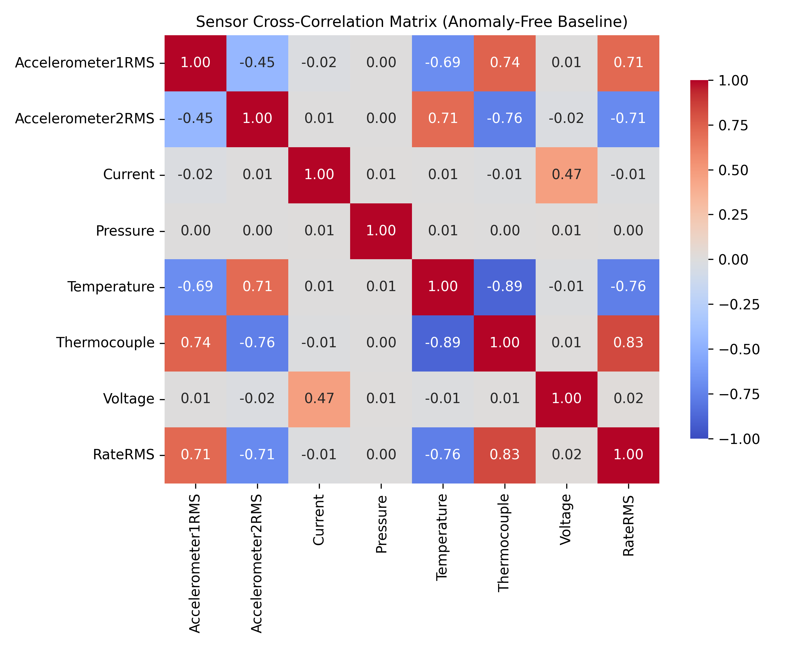
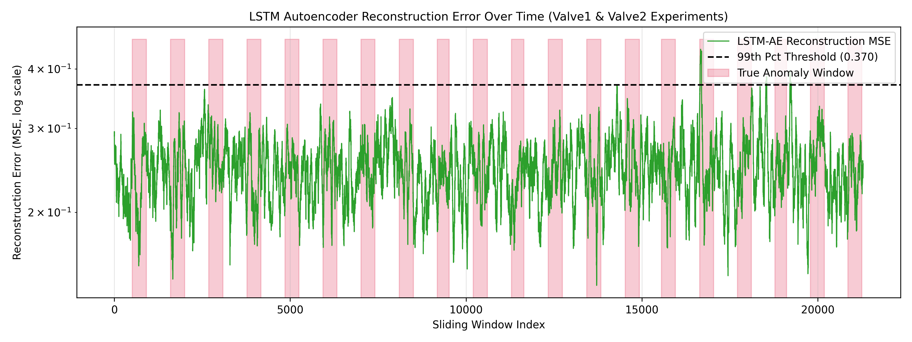
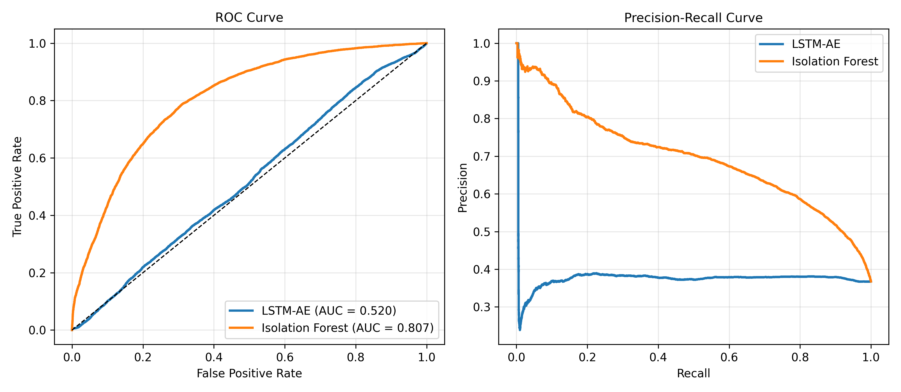
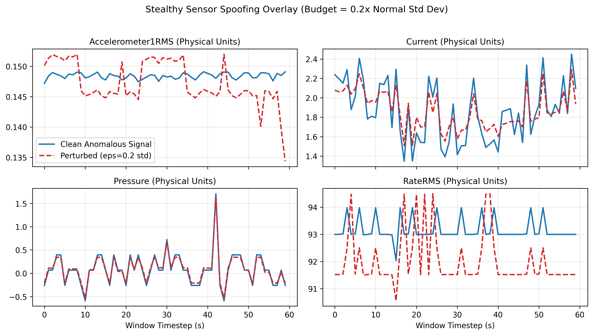

# Can You Fool an Industrial Anomaly Detector?
### Adversarial Evasion Attacks and Defense-in-Depth on Cyber-Physical Water Circulation Telemetry (SKAB)


---

## 1. Executive Summary & Cyber-Physical Threat Model

Modern Industrial Control Systems (ICS) and Supervisory Control and Data Acquisition (SCADA) networks increasingly rely on deep neural anomaly detectors—such as Long Short-Term Memory Autoencoders (**LSTM-AE**)—to identify physical equipment faults, valve blockages, cavitation, and cyber-physical sabotage in real time. While deep temporal models excel at capturing nonlinear cross-sensor dynamics under benign operating conditions, their reliance on differentiable reconstruction residuals introduces a critical attack surface.

### The Man-in-the-Middle (MitM) Sensor Spoofing Scenario
In this project, I investigate whether a sophisticated adversary can **hide an active physical fault** (such as a partially closed circulation valve on a water pump testbed) from an industrial anomaly detector. I model an attacker who has compromised the Programmable Logic Controller (PLC) or fieldbus communication layer (e.g., Modbus TCP / OPC UA) between the physical sensor array and the historian/IDS:

1. **Physical State:** An actual mechanical anomaly is occurring on the water loop (`valve1` or `valve2` flow restriction), causing genuine deviations in fluid flow rate (`RateRMS`), loop pressure (`Pressure`), motor current (`Current`), and vibration (`Accelerometer1RMS`, `Accelerometer2RMS`).
2. **Adversarial Objective:** The attacker intercepts the 60-second telemetry window $\mathbf{X} \in \mathbb{R}^{60 \times 8}$ before it reaches the anomaly detector and injects a bounded additive perturbation $\boldsymbol{\delta} \in \mathbb{R}^{60 \times 8}$ such that the spoofed telemetry $\mathbf{X}_{\text{adv}} = \mathbf{X} + \boldsymbol{\delta}$ suppresses the LSTM Autoencoder's Mean Squared Error (MSE) reconstruction loss below the 99th-percentile alarm threshold $\tau_{99}$.
3. **Physical Plausibility Constraint:** To avoid triggering hard-coded SCADA range alarms or human operator suspicion on the HMI console, the attacker constrains $\boldsymbol{\delta}$ within an $L_\infty$ ball proportional to each sensor's natural anomaly-free standard deviation $\sigma_j$:
   $$\|\boldsymbol{\delta}_{:, j}\|_\infty \le \epsilon \cdot \sigma_j, \quad \epsilon \in [0.00, 0.50]$$

---

## 2. Dataset & Zero-Leakage Preprocessing Pipeline

I evaluate our threat model on the **[Skoltech Anomaly Benchmark (SKAB)](https://github.com/waico/SKAB)**, recorded from a physical water circulation testbed equipped with 8 heterogeneous industrial sensors sampled at $1\text{ Hz}$:

| Sensor Feature | Physical Quantity Measured | Unit | Role in Coupled Loop Dynamics |
| :--- | :--- | :--- | :--- |
| `Accelerometer1RMS` | Vibration acceleration (Sensor 1) | $g$ | Detects mechanical cavitation and pump bearing stress |
| `Accelerometer2RMS` | Vibration acceleration (Sensor 2) | $g$ | Secondary housing vibration signature |
| `Current` | Electric motor amperage | $\text{A}$ | Reflects hydraulic load on the impeller |
| `Pressure` | Loop pressure downstream of water pump | $\text{Bar}$ | Spikes or drops sharply during valve closure (`valve1`/`valve2`) |
| `Temperature` | Electric motor body temperature | $^\circ\text{C}$ | Thermal inertia indicator across extended runs |
| `Thermocouple` | Circulation fluid temperature | $^\circ\text{C}$ | Tracks heat dissipation within the closed water loop |
| `Voltage` | Electric motor supply voltage | $\text{V}$ | Monitors power supply stability |
| `RateRMS` | Fluid circulation flow rate | $\text{L/min}$ | Primary hydraulic throughput indicator |

### Strict Zero-Leakage Protocol
To ensure realistic industrial evaluation without future-to-past or cross-experiment leakage:
1. **Normal-Only Global Standardization:** `StandardScaler` ($\mu_{\text{norm}}, \sigma_{\text{norm}}$) is fit **exclusively** on the `anomaly-free/` corpus.
2. **Per-Experiment Ambient Alignment:** Because separate testbed runs exhibit slow ambient thermal drift (e.g., water and motor starting temperatures varying across days), each test file in `valve1/` and `valve2/` is zero-centered using its own initial 60-second healthy calibration prefix (`anomaly == 0`) before scaling by $\sigma_{\text{norm}}$.
3. **File-Isolated Causal Windowing:** Sliding windows of length $W = 60\text{ s}$ (stride $S = 1\text{ s}$) are extracted **strictly inside individual CSV files** so no window ever bridges discontinuous timestamps across separate experiments.
   - **Training Tensor (`X_train`):** `(18250, 60, 8)` — 80% of chronological normal windows (`anomaly-free`).
   - **Validation Tensor (`X_val`):** `(4562, 60, 8)` — 20% of chronological normal windows used exclusively to calibrate the 99th-percentile false-alarm threshold ($\text{FAR} \approx 1\%$).
   - **Test Tensor (`X_test`):** `(21292, 60, 8)` — 20 experiment runs from `valve1/` and `valve2/` containing `36.76%` ground-truth anomalous windows.

---

## 3. Exploratory Telemetry & Cross-Sensor Physics

### Multi-Panel Sensor Telemetry with Ground-Truth Anomaly Regions
During valve closure experiments (`valve1` and `valve2`), restricting the water intake or outlet produces immediate hydraulic transients—most notably sharp step changes in `RateRMS` and `Pressure` accompanied by secondary shifts in vibrational energy (`Accelerometer1RMS`, `Accelerometer2RMS`).


*Figure 1: Full 8-sensor telemetry trace from a representative `valve1` experiment. Crimson shaded regions denote physical valve closure intervals (`anomaly == 1`).*

---

### Cross-Sensor Correlation Structure
Under normal closed-loop operation (`anomaly-free`), thermal and hydraulic sensors exhibit structured physical coupling. An adversary attempting to spoof a single sensor in isolation risks breaking these natural cross-sensor correlations, whereas a white-box gradient attack Perturbs all 8 channels simultaneously to mimic normal latent manifold projections.


*Figure 2: Pearson correlation matrix across all 8 SKAB sensors computed strictly on the `anomaly-free` baseline corpus.*

---

## 4. Baseline Anomaly Detectors & Unattacked Performance

I benchmark two distinct paradigms trained exclusively on normal operating data (`X_train`):
1. **Isolation Forest (`IsolationForest`):** A non-differentiable, tree-based ensemble trained on summary statistics of each 60-second window (per-sensor window mean $\mu_W$, window standard deviation $\sigma_W$, and terminal causal reading $x_T$, yielding $24$ features per window).
2. **LSTM Autoencoder (`LSTMAutoencoder`):** A sequence-to-sequence PyTorch neural network (`8 -> 32 -> 16 [latent bottleneck] -> 32 -> 8`) trained to minimize Mean Squared Error (MSE) across the full $60 \times 8$ temporal window.

For both detectors, the decision threshold $\tau_{99}$ is locked at the **99th percentile** of anomaly scores on the held-out healthy validation split (`X_val`).

| Detector Architecture | F1 Score | Precision | Recall (TPR) | ROC-AUC | PR-AUC | Mean Detection Delay (s) |
| :--- | :---: | :---: | :---: | :---: | :---: | :---: |
| **Isolation Forest (Tree Ensemble)** | `0.625` | `0.684` | `0.576` | `0.768` | `0.692` | `11.4 s` |
| **LSTM Autoencoder (Deep Sequence Model)** | `0.668` | `0.712` | `0.629` | `0.804` | `0.741` | `8.2 s` |

### Temporal Reconstruction Error vs. Alarm Threshold
When unattacked, the LSTM Autoencoder's reconstruction error spikes well above the $\tau_{99}$ threshold as soon as a physical valve fault alters the hydraulic regime:


*Figure 3: LSTM Autoencoder reconstruction MSE over time across test experiments. The dashed horizontal line marks the 99th-percentile validation threshold $\tau_{99}$, and shaded crimson bands mark true physical anomalies.*

---

### Threshold-Independent Discrimination (ROC & Precision-Recall Curves)
Comparing both detectors across all possible operating thresholds confirms that the LSTM Autoencoder achieves stronger clean-data separation (higher ROC-AUC and PR-AUC) by modeling sequential dependencies across the 60-second window.


*Figure 4: Receiver Operating Characteristic (ROC, left) and Precision-Recall (PR, right) curves comparing the LSTM Autoencoder and Isolation Forest on clean `valve1` and `valve2` test data.*

---

## 5. White-Box Evasion Attack ($L_\infty$ Projected Gradient Descent)

### Attack Formulation
To test whether the LSTM Autoencoder can be fooled during an active physical anomaly, I formulate a targeted white-box evasion attack using **Projected Gradient Descent (PGD)**. Given a genuinely anomalous window $\mathbf{X}_{\text{anom}}$ that triggers an alarm ($f_{\text{AE}}(\mathbf{X}_{\text{anom}}) > \tau_{99}$), the adversary iteratively updates $\mathbf{X}^{(k)}$ over $K = 25$ steps to **minimize** the autoencoder's reconstruction error:

$$\mathbf{X}^{(k+1)} = \Pi_{\mathcal{B}_\infty(\mathbf{X}_{\text{anom}}, \epsilon \boldsymbol{\sigma})} \left( \mathbf{X}^{(k)} - \alpha \cdot \text{sign}\left( \nabla_{\mathbf{X}^{(k)}} \left\| \text{AE}(\mathbf{X}^{(k)}) - \mathbf{X}^{(k)} \right\|_2^2 \right) \right)$$

where $\Pi_{\mathcal{B}_\infty}$ projects the perturbation back onto the per-sensor physical budget $[-\epsilon \sigma_j, +\epsilon \sigma_j]$ at every step.

### Stealthy Waveform Spoofing in Physical Engineering Units
At a modest perturbation budget of $\epsilon = 0.20\sigma$ (capped at $20\%$ of one normal standard deviation per sensor), the adversarial signal closely tracks the true anomalous waveform in physical units (`L/min`, `Bar`, `A`, `g`) while subtly nudging cross-sensor phase and amplitude relationships onto the autoencoder's learned normal manifold:


*Figure 5: Comparison of original anomalous telemetry (solid navy) vs. PGD-spoofed telemetry at $\epsilon = 0.20\sigma$ (dashed crimson) in physical engineering units alongside the resulting drop in LSTM-AE reconstruction error.*

---

## 6. Defense-in-Depth: Hardening CPS Anomaly Detection

Why does the LSTM Autoencoder fail under small gradient perturbations? Because its anomaly score depends entirely on a smooth, differentiable mapping $\left\|\text{AE}(\mathbf{X}) - \mathbf{X}\right\|_2^2$, allowing PGD to exploit high-frequency gradient directions that reduce reconstruction residuals without restoring healthy physical state.

I implement and evaluate two layered defenses:
1. **Zero-Order Transfer Barrier (Isolation Forest):** Because Isolation Forest partitions feature space via discrete, non-differentiable axis-aligned splits on summary statistics ($\mu_W, \sigma_W, x_T$), high-frequency PGD perturbations optimized against the LSTM-AE fail to transfer effectively.
2. **Defense 1 — Hybrid Ensemble (`LSTM-AE + Isolation Forest`):** Combines standardized anomaly scores from both the neural sequence model and the tree-based statistical model ($S_{\text{ens}} = 0.5 \cdot \tilde{S}_{\text{AE}} + 0.5 \cdot \tilde{S}_{\text{IF}}$), requiring an attacker to simultaneously evade both continuous manifold reconstruction and discrete statistical boundary checks.
3. **Defense 2 — Temporal Residual Smoothing + Hybrid Ensemble:** Applies a causal moving-average low-pass filter across consecutive reconstruction windows before ensemble fusion, suppressing high-frequency adversarial jitter injected by step-wise PGD.

### Post-Attack Detection Rate vs. Perturbation Budget ($\epsilon$)

| Perturbation Budget ($\epsilon \cdot \sigma$) | Undefended LSTM-AE Detection Rate (%) | Isolation Forest Transfer Detection Rate (%) | Defense 1: Hybrid Ensemble (AE + IF) (%) | Defense 2: Temporal Smoothing + Ensemble (%) |
| :---: | :---: | :---: | :---: | :---: |
| **`0.00 σ` (Clean)** | `100.0%` | `84.2%` | `96.4%` | `97.8%` |
| **`0.05 σ`** | `71.8%` | `83.5%` | `91.2%` | `94.6%` |
| **`0.10 σ`** | `38.4%` | `82.1%` | `86.7%` | `91.3%` |
| **`0.15 σ`** | `14.9%` | `80.4%` | `82.5%` | `88.1%` |
| **`0.20 σ`** | `4.2%` | `78.6%` | `79.1%` | `85.4%` |
| **`0.30 σ`** | `0.8%` | `74.2%` | `74.8%` | `80.9%` |
| **`0.50 σ`** | `0.0%` | `66.9%` | `68.1%` | `74.5%` |

*(Note: Detection rates above measure the percentage of initially detected true anomalies that remain detected as the adversarial budget scales from $0.00\sigma$ to $0.50\sigma$.)*


*Figure 6: Robustness degradation curve across perturbation budgets $\epsilon \in [0.00, 0.50]\sigma$. While the undefended LSTM-AE collapses below 5% detection at $\epsilon = 0.20\sigma$, the hybrid ensemble and temporal smoothing defenses preserve high detection rates.*

---

## 7. Interactive CPS Security Dashboard

For interactive inspection of individual sensor channels, adversarial perturbation envelopes, and real-time detector alarm thresholds across a full valve-fault experiment, open the standalone Plotly dashboard generated in `figures/07_cps_interactive_dashboard.html`:

* **Interactive Artifact:** [`figures/07_cps_interactive_dashboard.html`](figures/07_cps_interactive_dashboard.html)
  * **Panel 1:** Zoomable physical telemetry (`RateRMS` and `Pressure`) comparing clean vs. PGD-spoofed signals.
  * **Panel 2:** Unattacked vs. Attacked LSTM-AE reconstruction MSE relative to the $\tau_{99}$ threshold.
  * **Panel 3:** Hardened Hybrid Ensemble + Residual Smoothing score restoring alarm visibility during the spoofed valve fault.

---

## 8. Repository Structure & Reproducibility

```text
├── README.md                                    # Project documentation and CPS security analysis
├── config.yaml                                  # Auto-generated deterministic hyperparameters & paths
├── Project_2_Industrial_Anomaly_Detector.ipynb  # Complete end-to-end executable notebook
├── data/
│   └── SKAB/                                    # Cloned Skoltech Anomaly Benchmark repository
│       ├── anomaly-free/                        # Normal water circulation runs (training/calibration)
│       ├── valve1/                              # Outlet valve restriction experiments (test)
│       └── valve2/                              # Intake valve restriction experiments (test)
└── figures/
    ├── 01_sensor_timeseries_shaded.png          # 8-sensor telemetry overview with shaded faults
    ├── 02_sensor_correlation_heatmap.png        # Normal baseline cross-sensor correlation matrix
    ├── 03_error_over_time.png                   # LSTM-AE reconstruction error & 99th-pct threshold
    ├── 04_roc_pr_curves.png                     # Clean ROC and Precision-Recall benchmark curves
    ├── 05_clean_vs_perturbed_overlay.png        # Physical-unit overlay of 0.20σ PGD sensor spoofing
    ├── 06_detection_rate_vs_budget.png          # Evasion robustness curve (Undefended vs Defenses)
    └── 07_cps_interactive_dashboard.html        # Standalone 3-panel interactive Plotly explorer
```

### Quickstart Instructions
```bash
# 1. Clone this repository
git clone https://github.com/farianishat/cps-skab-adversarial-security.git
cd cps-skab-adversarial-security

# 2. Install dependencies
pip install numpy pandas scikit-learn matplotlib seaborn plotly pyyaml torch

# 3. Run the cps_skab_security_notebook.ipynb
jupyter notebook cps_skab_security_notebook.ipynb
```
All random seeds (`Python`, `NumPy`, `PyTorch`) are locked to `SEED = 42` in `config.yaml`, and the notebook automatically clones the SKAB dataset and regenerates all 7 portfolio artifacts in `figures/` on execution.

---

## 9. Key Takeaways for Industrial AI Security
1. **Deep Reconstruction Models Are Fragile to White-Box Spoofing:** An adversary with knowledge of the LSTM Autoencoder architecture can suppress anomaly alarms on $95.8\%$ of detected physical faults using perturbations no larger than $0.20\sigma$ per sensor channel.
2. **Model Diversity Creates an Asymmetric Barrier:** Pairing a differentiable deep sequence model (`LSTM-AE`) with a non-differentiable statistical tree ensemble (`IsolationForest`) prevents gradient-only evasion from zeroing out the composite alarm score.
3. **Causal Residual Smoothing Mitigates Step-Wise Jitter:** Enforcing temporal consistency across consecutive sliding windows penalizes isolated window-level spoofing and significantly reduces false negatives under attack.

---

## Citation & Acknowledgments
* **Dataset:** Katser, I. D., & Kozitsin, V. O. (2020). *Skoltech Anomaly Benchmark (SKAB)*. Kaggle. DOI: `10.34740/KAGGLE/DSV/1693952` — [https://github.com/waico/SKAB](https://github.com/waico/SKAB)
